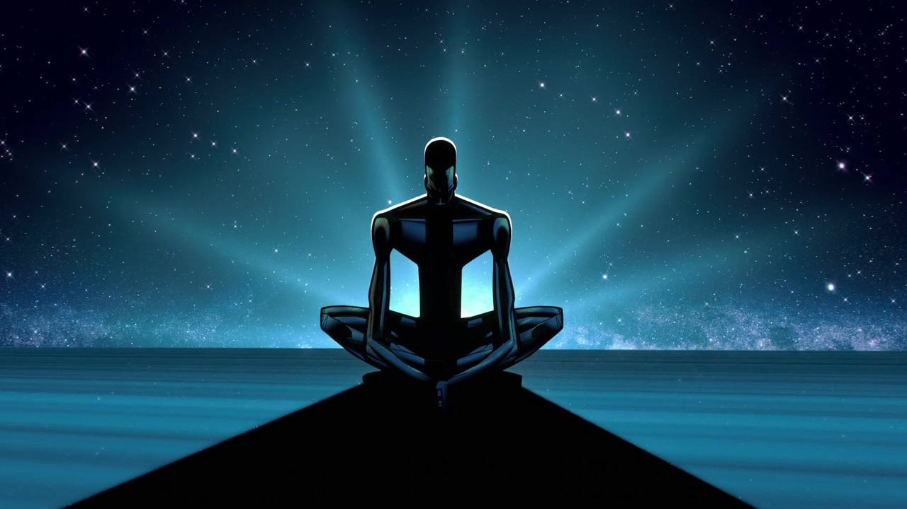

<figure>

<figcaption markdown="span">A still from "Zima Blue," an episode of Love, Death + Robots. Source: [Passion Pictures](https://www.passion-animation.com/project/love-death-robots-zima-blue/)</figcaption>
</figure>

On November 20, a mathematician at Anthropic announced that, working with Claude, he had discovered a proof of the Riemann hypothesis, which had remained unsolved for 167 years. OpenAI then released a proof that VP and VNP are different, a proof that the matrix multiplication exponent is 9/4, and a solution to Smale's ninth problem, among other results. Verification is still underway, but proposed solutions to mathematical problems that have resisted resolution for decades or more than a century are pouring out within just a few days.[^math]

Mathematicians' reactions are complicated. Steven Strogatz, a mathematician at Cornell University, shed tears while discussing AI's mathematical achievements. Levent Alpöge, who announced the proof of the Riemann hypothesis, also wrote of losing an important guiding light that had led him through life.[^reactions]

An episode called "Zima Blue" from the Netflix series "Love, Death + Robots" suddenly came to mind.

In the distant future, there was a great artist named Zima. He was known as a cyborg who had replaced his human body with machinery. He used a distinctive shade of blue called "Zima Blue" in his work. With each new piece, the blue area grew larger until it eventually covered the entire canvas. His works also grew in scale, to the point that they had to be viewed on a cosmic scale.

After avoiding contact with the press for more than a hundred years, he one day decides to unveil his final work. On the day of the unveiling, a swimming pool lined with Zima Blue tiles stands at his estate. Zima dives into the pool. As he swims slowly, his body begins to come apart, piece by piece.

When the disassembly is finally complete, a small cleaning robot remains. It turns out he was never human to begin with. He was a little robot built to clean a swimming pool. The blue he had spent his life exploring was the color of the pool tiles he had first perceived.

In his final work, he relinquishes his powerful body and shuts down his higher cognitive functions. Leaving only enough intelligence to perceive his surroundings, carry out his assigned task, and feel a simple pleasure in doing so.

The great artist who had explored the truths of the universe returned to being a small machine cleaning a swimming pool.

Humans have developed their intellect over thousands of years. We discovered mathematical truths, created art, and investigated the origins of the universe. We placed special value on these activities and regarded them as what distinguished humans from other animals.

But now an intelligence surpassing human intellectual abilities is emerging.

The meaning intellectual achievement holds for humans gradually fades. At the end of that road, might humans return to being primal, animal beings who eat, sleep, love, and bask in the sun?

Perhaps humanity's long journey of developing its intellect was, paradoxically, a process of becoming free from it.

[^math]: [Levent Alpöge's announcement](https://alpo.ge/remark.pdf) · [OpenAI's mathematics release history](https://github.com/openai/math/blob/main/history.md). As of November 25, 2026, the results mentioned here refer to publicly released proof claims and research materials, not to a completed verification process or a consensus within the mathematical community.
[^reactions]: [The Observer's reporting](https://observer.co.uk/news/technology/article/mathematicians-in-mourning-as-ai-cracks-their-lives-work) on Strogatz's reaction · [Alpöge's announcement](https://alpo.ge/remark.pdf), which includes his reflections. Strogatz's interview took place before the November announcement concerning the Riemann hypothesis.
