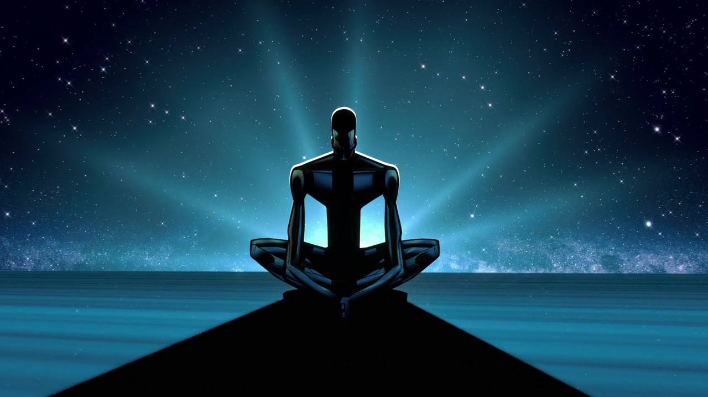

<figure>

<figcaption markdown="span">〈러브, 데스 + 로봇〉의 '지마 블루' 스틸. 출처: [Passion Pictures](https://www.passion-animation.com/project/love-death-robots-zima-blue/)</figcaption>
</figure>

지난 11월 20일, 앤트로픽 소속 수학자가 Claude와 함께 167년간 풀리지 않았던 리만 가설의 증명을 발견했다고 발표했다. 이어 오픈AI는 VP와 VNP가 서로 다르다는 증명과 행렬 곱셈의 복잡도 지수가 9/4라는 증명, 스메일의 아홉 번째 문제에 대한 해법 등을 공개했다. 아직 검증이 진행 중이지만, 수십 년에서 백 년 넘게 풀리지 않았던 수학적 난제들에 대한 해법이 불과 며칠 사이에 쏟아져 나오고 있다.[^math]

수학자들의 반응은 복잡하다. 코넬대학교의 수학자 스티븐 스트로가츠는 AI의 수학적 성취에 대해 이야기하던 중 눈물을 흘렸다. 리만 가설의 증명을 발표한 레벤트 알푀게 역시 자신의 삶을 이끌어 온 중요한 길잡이를 잃었다는 소회를 밝혔다.[^reactions]

문득 넷플릭스 시리즈 '러브, 데스 + 로봇'의 '지마 블루'라는 에피소드가 생각났다.

먼 미래, 지마라는 위대한 예술가가 있었다. 지마는 인간의 신체를 기계로 대체한 사이보그로 알려져 있었다. 그는 자신의 작품에 '지마 블루'라는 특유의 푸른색을 사용했다. 작품을 거듭할수록 푸른색의 영역은 넓어졌고, 마침내 캔버스 전체를 뒤덮었다. 작품의 규모도 점차 커져 우주 단위로 감상해야 하는 지경에 이르렀다.

100년 넘게 언론과의 접촉을 피해 온 그는 어느 날 자신의 마지막 작품을 공개하기로 한다. 공개 당일, 그의 저택에는 지마 블루 색상의 타일로 채워진 수영장이 놓여 있었다. 지마는 수영장에 뛰어든다. 천천히 유영하던 지마의 신체가 하나씩 분해되기 시작한다.

마침내 분해가 끝났을 때, 작은 청소 로봇 하나가 남았다. 알고 보니 그는 애초에 인간이 아니었다. 수영장을 청소하기 위해 만들어진 작은 로봇이었다. 그가 평생에 걸쳐 탐구했던 푸른색은 자신이 처음으로 인식했던 수영장 타일의 색이었다.

마지막 작품에서 그는 강인한 신체를 내려놓고, 고등 사고 기능을 정지시킨다. 주변을 인식하고, 주어진 일을 수행하며, 그로부터 소박한 즐거움을 느낄 수 있을 정도의 지능만을 남긴 채.

우주의 진리를 탐구하던 위대한 예술가는 다시 수영장을 청소하는 작은 기계로 돌아갔다.

인간은 수천 년에 걸쳐 지성을 발전시켜 왔다. 수학적 진리를 발견하고, 예술을 창조하고, 우주의 기원을 탐구했다. 이러한 행위에 특별한 가치를 부여해 왔으며, 그것이 인간을 다른 동물과 구별하는 특징이라고 생각해 왔다.

그러나 이제 인간의 지적 능력을 넘어서는 지성이 등장하고 있다.

지적 성취가 인간에게 갖는 의미는 점차 희미해진다. 그 끝에서 인간은 다시 먹고, 자고, 사랑하고, 햇볕을 쬐는 원초적인 동물적 존재로 돌아가지 않을까?

인류가 그토록 오랜 시간에 걸쳐 지성을 발전시켜 온 것은, 역설적으로 지성으로부터 해방되기 위한 과정이었을지도.

[^math]: [Levent Alpöge의 발표문](https://alpo.ge/remark.pdf) · [OpenAI 수학 연구 공개 이력](https://github.com/openai/math/blob/main/history.md). 2026년 11월 25일 기준, 여기서 언급한 결과는 공개된 증명 주장과 연구 자료를 가리키며, 검증이 모두 끝나 수학계의 합의가 이루어졌다는 뜻은 아니다.
[^reactions]: 스트로가츠의 반응에 관한 [The Observer 보도](https://observer.co.uk/news/technology/article/mathematicians-in-mourning-as-ai-cracks-their-lives-work) · 알푀게의 소회가 담긴 [발표문](https://alpo.ge/remark.pdf). 스트로가츠의 인터뷰는 11월의 리만 가설 발표 이전에 이루어졌다.
